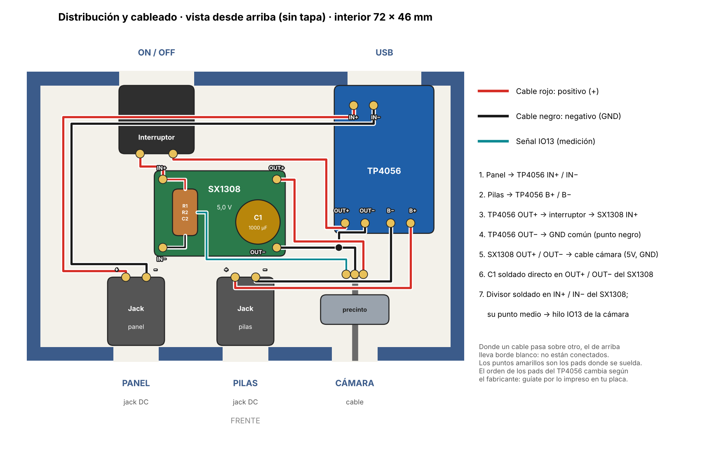
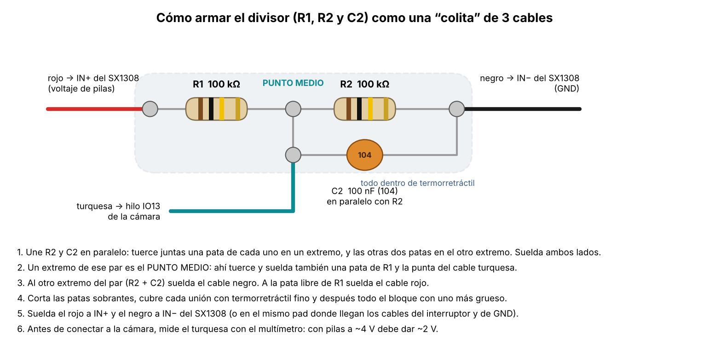
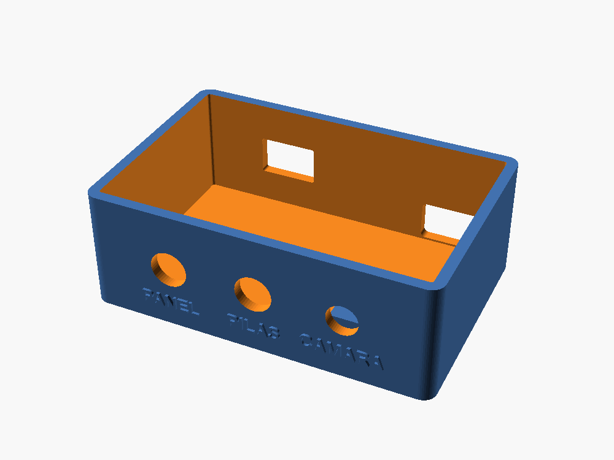
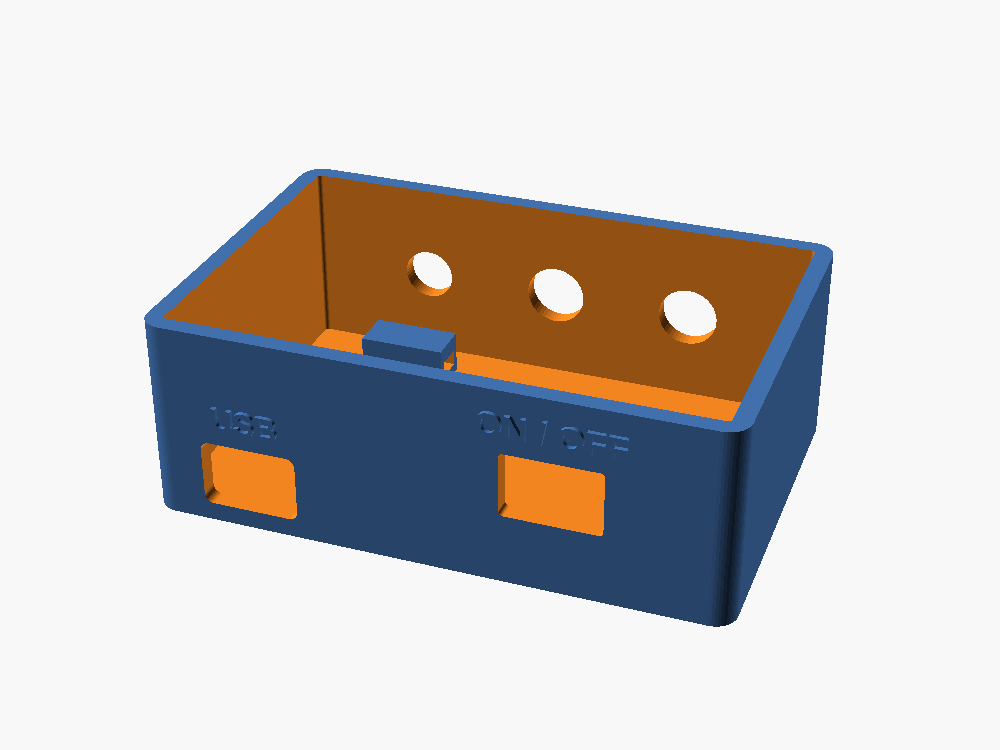

# Hardware: energía y caja de la cámara

Alimentación solar de cada ESP32-CAM de ParkVision, cómo se cablea dentro de la caja y los modelos
3D para imprimir. El firmware no depende de nada de esta carpeta: Arduino solo compila la raíz y
`src/`.

Las restricciones de pines y del divisor de batería (GPIO13, R8, microSD) están en `CLAUDE.md`,
sección "Hardware". Lo de aquí no las sustituye.

## Topología

```
Panel solar ──► [D1 Schottky, opcional] ──► TP4056 IN+/IN−        (USB del TP4056 = carga manual)
                                            TP4056 B+/B− ──► celdas 18650 en paralelo (1S)
                                            TP4056 OUT+ ──► interruptor ──► elevador VIN+ ──► 5,0–5,1 V ──► ESP32-CAM 5V
                                                                                 │
                                                       divisor R1/R2 + C2 ◄──────┘ (voltaje de las celdas) ──► GPIO13
GND común: TP4056 OUT− = elevador VIN−/VOUT− = GND de la cámara. A B− solo van las celdas.
```

- **Nunca** conectar el panel y el USB del TP4056 a la vez.
- El divisor sale de **VIN+ del elevador** (celdas, después del interruptor), nunca de los 5 V.
- En el módulo del elevador, VIN− y VOUT− son el mismo cobre. Comprobarlo con el multímetro en
  continuidad antes de confiar en ello.

## Componentes

| Ref | Componente | Valor / modelo | Nota |
|---|---|---|---|
| — | Celdas Li-ion 18650 | Iguales, en paralelo | Mismo modelo y lote; igualar el voltaje (< 0,1 V de diferencia) antes de unirlas |
| — | Cargador | TP4056 **con protección** (6 pads) | El de 4 pads no protege las celdas |
| — | Elevador | MT3608 o SX1308 (HW-668) | Ajustado a 5,0–5,1 V |
| — | Interruptor | Rocker KCD11 | Entre TP4056 OUT+ y VIN+ del elevador |
| — | Panel solar | 6 V, 2–3 W recomendado | Ver "Panel solar" |
| D1 | Diodo Schottky | 1N5819 / 1N5817 / SS34 | Opcional; protege el TP4056 si se invierte el panel. No usar 1N4007 |
| C1 | Electrolítico | 1000 µF / 16 V | En VOUT+/VOUT− del elevador; raya (−) a GND |
| C2 | Cerámico | 100 nF (104) | En paralelo con R2 |
| R1, R2 | Resistencias 1/4 W | 100 kΩ, 1 % o 5 % | Iguales; la calibración de dos puntos absorbe la tolerancia |
| — | Jack DC hembra de chasis | 5,5 × 2,1 mm, rosca de 8 mm (DC-099) | Panel y celdas; centro = positivo |
| — | Cable | 20–22 AWG multifilar, rojo y negro | |

### MT3608 frente a SX1308

En la práctica son equivalentes: los dos aceptan 2–24 V de entrada, dan 5 V a ~1 A con una celda
de 3,7 V y rinden ~85–90 %. El SX1308 (HW-668) es más pequeño (~22 × 17 mm frente a ~36 × 17 mm),
que es lo que importa en la caja compacta. Ambos tienen un potenciómetro de varias vueltas: si
queda alto, sacan 12 V o más y queman la cámara. Ajustar **sin la cámara conectada**, medir 5,0–5,1 V
y fijar el tornillo con una gota de esmalte o silicona.

## Cableado dentro de la caja



Las líneas indican qué se une con qué, no el recorrido exacto. El orden de los pads del TP4056
cambia según el fabricante: manda lo impreso en la placa.

### Divisor de batería



R1 entre VIN+ y el punto medio; R2 y C2 entre el punto medio y GND; el punto medio va a GPIO13.
Se puede soldar como una "colita" de tres cables o directamente sobre los pads VIN+/VIN− del
elevador, con el punto medio aislado en termorretráctil y fijado con silicona. Antes de conectar la
cámara, el punto medio debe dar ~Vbat/2 (≈ 2,0 V con la celda a 4,0 V). Si con la placa conectada
sube a ~2,6 V, la placa trae R8: ver `CLAUDE.md`.

## Protección y corte por batería baja

| Nivel (por celda) | Quién | Qué hace |
|---|---|---|
| 4,20 V | TP4056 | Fin de carga |
| ~4,3 V | Protección DW01A del módulo | Corte por sobrecarga |
| **3,4 V** | Firmware (`BATTERY_RESUME_MV`) | Vuelve a transmitir tras un corte |
| **3,3 V** | Firmware (`BATTERY_CUTOFF_MV`) | Duerme sin encender cámara ni WiFi |
| ~2,4 V | Protección DW01A del módulo | Desconecta OUT; se restablece hacia 3,0 V al cargar |

El corte principal es el del firmware, no el del módulo. Es igual con MT3608 o con SX1308: los dos
siguen funcionando por debajo de 3 V, y el límite lo ponen las celdas.

Por qué 3,3 V y no 3,0 V:

1. **Casi no queda energía.** Por debajo de ~3,4 V la curva cae en picada: a 3,3 V queda ~3 % de la
   capacidad. Bajar a 3,0 V da horas, no días.
2. **La lectura es en reposo.** Al transmitir, el elevador pide ~1 A a las celdas y su resistencia
   interna (más cables y protección) baja el voltaje 0,1–0,2 V. Con la celda casi vacía, la caída
   crece, y la calibración tiene ±0,1 V de error.
3. **Bucle de brownout.** Si el voltaje cae en un pico, la placa se reinicia (`reset_reason` 9),
   vuelve a intentarlo y vuelve a caer: gasta más y no sube fotos.
4. **Margen hasta el corte del módulo.** Tras el corte la placa sigue en deep sleep; desde 3,3 V
   queda tiempo para que el panel recupere la celda antes de llegar a zona dañina.
5. **Vida útil.** Descargar a fondo con frecuencia desgasta las celdas.

Para bajar el corte con datos: registrar el voltaje mínimo durante los envíos. Si tras varios días
nunca baja de ~3,1 V y no hay brownouts, se puede llevar a 3,2 V. A 3,0 V no.

## Panel solar

- **Orientación:** hacia el **norte** (hemisferio sur), inclinado 15–20°, sin ninguna sombra
  parcial, limpio y con aire detrás. Las celdas y la electrónica, a la sombra.
- **Tamaño:** un panel de 5,5 V / 100 mA (~0,55 W) no basta en el invierno nublado de Lima. Uno de
  6 V y 2–3 W da margen. Son estimaciones: el consumo real depende de `CAPTURE_INTERVAL_MS` (30 s)
  y hay que medirlo.
- **Antes de conectar:** medir el panel al sol sin carga. Un panel de "6 V" puede dar 7–7,5 V;
  el TP4056 admite ~8 V como máximo.
- **Comprobar si es autosostenible:** anotar el voltaje cada mañana durante una semana. Si se
  mantiene o sube, lo es.

## Modelos 3D (`3d/`)

| Archivo | Qué es |
|---|---|
| `caja_puertos_base.stl`, `caja_puertos_tapa.stl` | Caja de energía, sin placa perforada: módulos pegados al piso |
| `caja_puertos.scad` | Fuente editable de la caja (OpenSCAD) |
| `case_camara_base.stl`, `case_camara_tapa.stl` | Case de la ESP32-CAM, con hueco para el pin IO13 |
| `soporte_pared_camara.stl` | Soporte de pared del case |

**Caja de energía:** exterior 76,8 × 52 × 27 mm, interior 72 × 46 × 25 mm, tapa a presión.

| Lado | Qué tiene |
|---|---|
| Frente | PANEL y PILAS: agujeros de 8,2 mm para jack DC-099; CÁMARA: pasacables de 7 mm con anclaje interior para precinto |
| Atrás | Hueco de 13 × 9 mm para el USB del TP4056 e interruptor KCD11 (13,2 × 8,8 mm) |

 

Para otro jack o interruptor se cambian los parámetros al inicio de `caja_puertos.scad`
(`diametros`, `usb_*`, `sw_*`) y se reexporta con
`openscad -D 'part="base"' -o caja_puertos_base.stl caja_puertos.scad` (y `part="tapa"`).

**Impresión:** PETG (ASA si va al sol directo), color claro, capa de 0,28 mm, 3 paredes, 15–20 %
de relleno, sin soportes. Montar la caja con los agujeros hacia abajo para que no entre agua.

## Pendiente

- El jack DC conseguido es el de **bornera de tornillos** (sin rosca), no el DC-099: no se fija en el
  agujero de 8,2 mm. O se cambia por un DC-099, o hay que adaptar la caja (boca de ~10,8 mm y soporte
  interior, ~10–12 mm más de fondo).
- Confirmar con el TP4056 real la altura y posición del USB respecto al hueco trasero.
- Medir el consumo real en deep sleep (multímetro en mA en serie con el positivo de las celdas).
